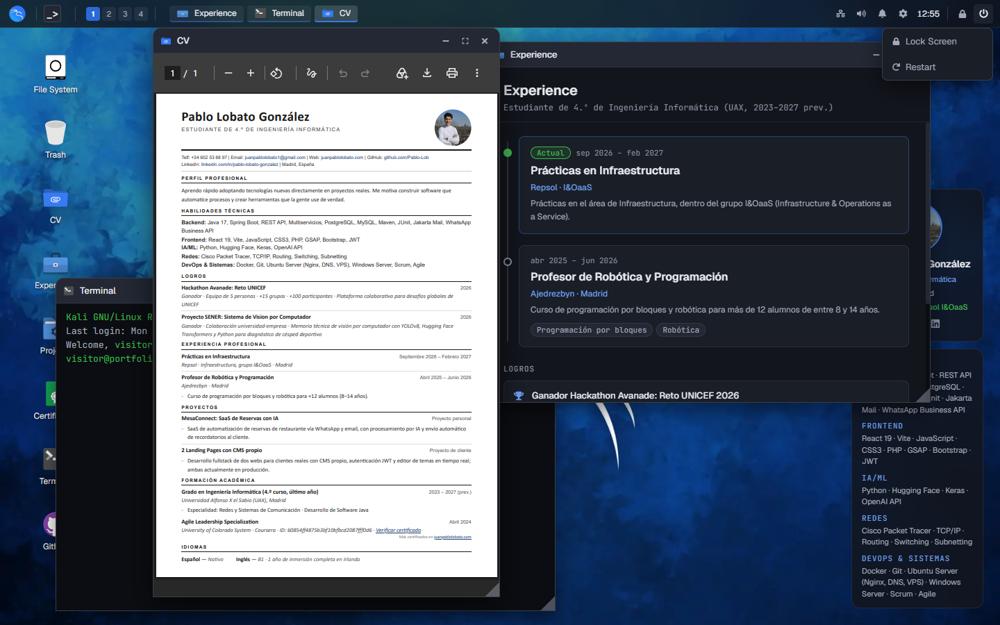

# Portfolio — Kali Linux OS Style

Portfolio de **Pablo Lobato González** (Ingeniería Informática · Madrid, prácticas en Repsol I&OaaS). Interactivo que simula un escritorio Kali Linux / GNOME en el navegador. En lugar de una página estática, el visitante interactúa con un sistema operativo ficticio: arranca, inicia sesión y navega por aplicaciones reales que exponen proyectos, habilidades y CV.

---

## Demo

> **Live:** *(pendiente de despliegue — ejecuta `npm run dev` para verlo localmente)*



---

## Tecnologías

| Capa | Herramienta |
|---|---|
| UI Framework | React 19 |
| Bundler | Vite 7 (rolldown-vite) |
| Iconos | react-icons 5 |
| Estilos | CSS plano por componente (`src/styles`) |
| Linting | ESLint 9 |
| Lenguaje | JavaScript (ESM) |

Sin librerías de UI externas — todo el sistema de ventanas, taskbar y terminal están construidos desde cero.

---

## Arquitectura del proyecto

```
Portfolio/
│
├── public/
│   ├── files/
│   │   ├── cv/                  # CV_ES.pdf · CV_EN.pdf
│   │   └── certificates/        # PDFs de certificados
│   ├── favicon.png · apple-touch-icon.png · og-image.png
│   ├── robots.txt
│   └── sitemap.xml
│
└── src/
    ├── assets/
    │   ├── icons/               # SVGs del escritorio (terminal, carpeta, proyectos…)
    │   ├── images/              # Wallpapers, logo Kali, foto de perfil
    │   └── sounds/              # (reservado)
    │
    ├── components/
    │   ├── os/                  # Capa del sistema operativo
    │   │   ├── BootScreen.jsx   # Login animado (saltable con clic/Enter/Esc; una vez por sesión)
    │   │   ├── DesktopShell.jsx # Escritorio: taskbar, iconos, widgets, ventanas
    │   │   ├── Clock.jsx        # Reloj aislado para no re-renderizar el escritorio
    │   │   ├── DesktopIcon.jsx  # Icono del escritorio (doble clic o Enter)
    │   │   ├── Window.jsx       # Marco arrastrable (Pointer Events) con apps cargadas con React.lazy
    │   │   └── (ver components/mobile/MobileShell.jsx para la versión móvil)
    │   │
    │   └── apps/                # Aplicaciones que se abren dentro de Window
    │       ├── Terminal.jsx     # Terminal interactiva con ~20 comandos propios (salida escapada)
    │       ├── Experience.jsx   # Timeline de experiencia y logros
    │       ├── CVViewer.jsx     # Lector de PDF con detección de idioma (ES/EN)
    │       ├── Certificates.jsx # Galería de certificados de Coursera
    │       ├── FileExplorer.jsx # Explorador de archivos estilo Nautilus
    │       └── Projects.jsx     # Tarjetas de proyectos con tech stack y enlaces
    │
    ├── hooks/
    │   └── useDismiss.js        # Cierra menús con clic fuera / Esc
    │
    ├── utils/
    │   ├── lang.js              # Detección de idioma (ES/EN) y pickLang
    │   └── format.js            # Formato de fechas de experiencia
    │
    ├── data/                    # Fuente única de contenido
    │   ├── profile.js           # Nombre, rol, contacto, idiomas, logros
    │   ├── skills.js            # Skills por categoría (sin porcentajes)
    │   ├── experience.js        # Experiencia laboral (Repsol, Ajedrezbyn…)
    │   ├── projects.js          # Proyectos (id, name, tech, github, live…)
    │   ├── certificates.js      # Lista de certificados con rutas a los PDFs
    │   ├── docs.js              # README.md y experience.md virtuales
    │   └── fileSystem.js        # Definición del sistema de archivos virtual del escritorio
    │
    ├── styles/                  # CSS por componente
    ├── App.jsx                  # Kernel: BootScreen → Desktop
    └── main.jsx                 # Entry point
```

---

## Flujo de la aplicación

```
[BootScreen]  →  secuencia de arranque animada  →  pantalla de login
     ↓
[Desktop]     →  taskbar GNOME + iconos + widgets de habilidades
     ↓
[Window]      →  contenedor arrastrable/maximizable para cada app
     ├── Terminal     — comandos: about, skills, experience, projects, contact, neofetch, cv, ls, whoami…
     ├── Experience   — timeline: Repsol (actual), Ajedrezbyn y logros
     ├── CVViewer     — iframe con CV_ES.pdf o CV_EN.pdf según navigator.language
     ├── Projects     — tarjetas de proyectos con accent color y enlaces a GitHub
     ├── Certificates — visor de PDFs de Coursera
     └── FileExplorer — explorador de archivos virtual (README.md, experience.md…)
```

---

## Apps disponibles

### Terminal
Terminal funcional con historial de comandos (↑/↓), autocompletado con Tab y Ctrl+L para limpiar.

| Comando | Descripción |
|---|---|
| `help` | Lista de comandos disponibles |
| `about` | Presentación personal |
| `skills` | Habilidades técnicas |
| `experience` / `work` | Experiencia y logros |
| `projects` | Listado de proyectos |
| `contact` | Email, GitHub, LinkedIn |
| `cv` | Abre el CVViewer |
| `neofetch` | Info del sistema con foto de perfil |
| `ls` | Lista archivos del directorio virtual |
| `whoami` | Usuario actual |
| `date` | Fecha y hora reales |
| `echo <msg>` | Imprime un mensaje |
| `ping <host>` | Simula ping |
| `uname -a` | Kernel falso estilo Kali |
| `cat README.md` / `cat experience.md` | Muestra los documentos virtuales |
| `clear` / Ctrl+L | Limpia la pantalla |

### CVViewer
Detecta automáticamente el idioma del navegador (`navigator.language`) para servir `CV_ES.pdf` o `CV_EN.pdf`. Si el archivo no existe, muestra las rutas correctas donde colocarlo.

### Experience
Timeline vertical con las prácticas en Repsol (Infraestructura, I&OaaS, sep 2026 – feb 2027), la experiencia previa en Ajedrezbyn y los logros (Hackathon Avanade UNICEF 2026, Proyecto SENER 2026). Contenido en `src/data/experience.js` y `src/data/profile.js`.

### Projects
Seis proyectos con tarjeta visual:
- **MesaConnect** — SaaS de reservas de restaurante vía WhatsApp y email con IA
- **MIVS Global** e **ITS Stones** — landing pages con CMS propio (JWT, editor de temas), en producción
- **Infraestructura de Red Municipal** — OSPF/BGP/VPN con Cisco Packet Tracer
- **Portfolio OS** — este mismo proyecto
- **HobbiesApp** — prototipo UX/UI en Figma

### Widgets del escritorio
Perfil (nombre, estado actual) y skills por categoría, alimentados desde `src/data/skills.js`.

---

## Instalación y desarrollo

```bash
# Instalar dependencias
npm install

# Servidor de desarrollo
npm run dev

# Build de producción
npm run build

# Previsualizar el build
npm run preview
```

### Añadir el CV

Coloca los PDFs en las rutas correctas antes de hacer build:

```
public/files/cv/CV_ES.pdf
public/files/cv/CV_EN.pdf
```

### Añadir certificados

```
public/files/certificates/<nombre>.pdf
```

Y registra cada certificado en `src/data/certificates.js`.

---

## Autor

**Pablo Lobato González**
Estudiante de 4.º de Ingeniería Informática (UAX) — Madrid

- Web: [juanpablolobato.com](https://juanpablolobato.com)
- GitHub: [github.com/Pablo-Lob](https://github.com/Pablo-Lob)
- LinkedIn: [pablo-lobato-gonzalez](https://www.linkedin.com/in/pablo-lobato-gonz%C3%A1lez-536b67221)
- Email: pablolobatodev@outlook.com
